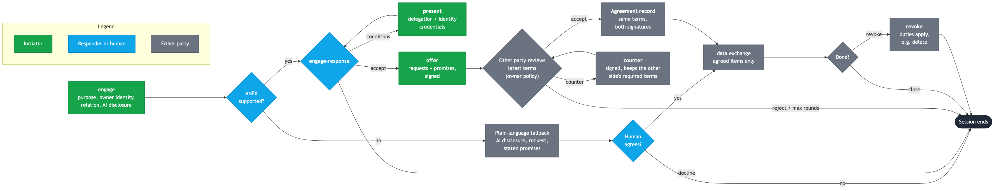
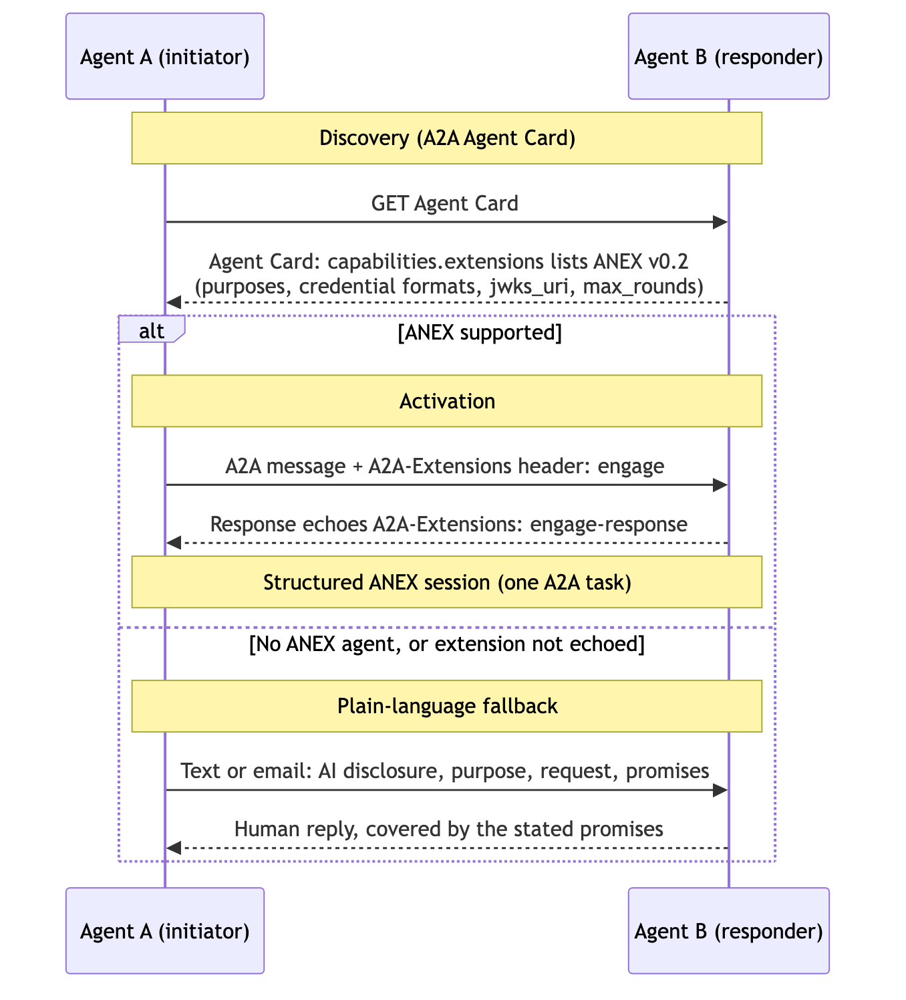
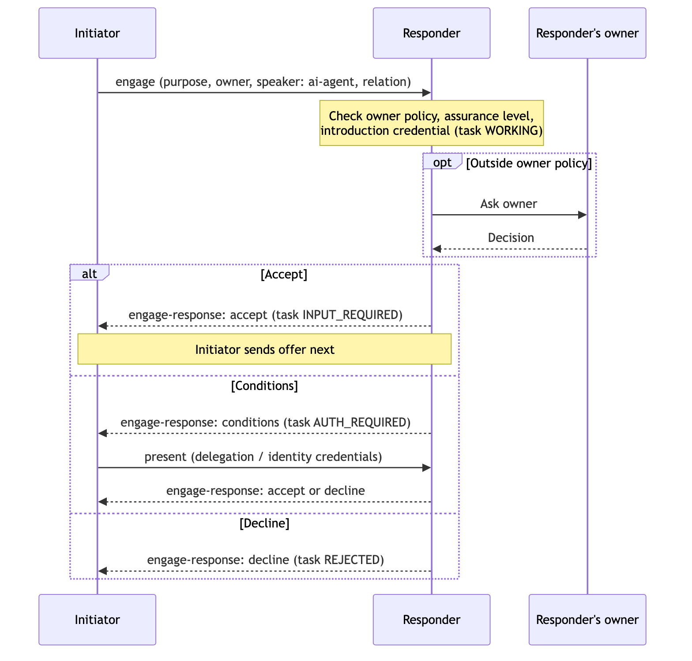
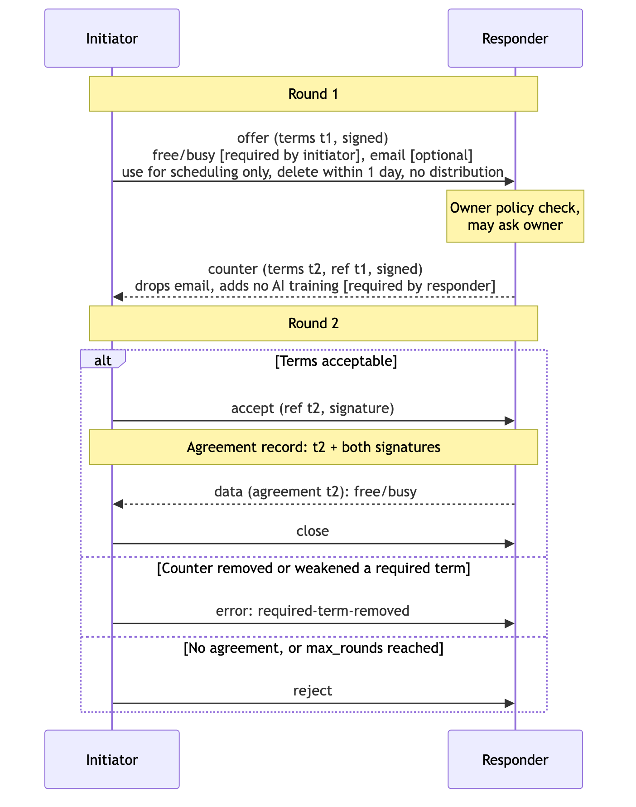

# Agent Negotiation & Exchange Protocol (ANEX) Draft

> **Status (October 2026):** This draft was written in late 2024, before today's agent standards had settled. Since then, [A2A](https://a2a-protocol.org/) has become the common transport and discovery layer for agent-to-agent messaging. [MCP](https://modelcontextprotocol.io/) covers tool and data access, and the [Personal Agent Protocol (Poppy)](https://personalagentprotocol.org/) covers how a personal agent works with a *company*. Those standards replace much of the transport, handshake and authentication material below. What they don't yet address is the core of ANEX: **two people's agents negotiating terms with each other**, where each side states what it wants access to and what it promises about the data it receives, with social context as a trust signal. See [Section 1.1](#11-relation-to-current-standards).
>
> **[ANEX v0.2](spec/v0.2.md)** rebuilds the protocol on those standards: it is an A2A extension that uses RFC 9396 for access requests, W3C ODRL for promises, and Verifiable Credentials for identity, delegation and introductions. The rest of this page is the original v0.1 draft, kept for reference.

## **1. Introduction**

The **Agent Negotiation & Exchange Protocol (ANEX)** is a handshake and data exchange protocol for AI-powered Personal Agents (PAs). These agents act as proxies for their owners, individuals or entities, and make decisions on their behalf, sometimes with a human in the loop. The goal of ANEX is to let any PA engaging with another PA identify protocol compliance, establish terms, and define the scope of an exchange of data and/or value.

ANEX messages follow a speech-act style inspired by the **Foundation for Intelligent Physical Agents (FIPA)** Agent Communication Language: each message carries a performative (`INFORM`, `PROPOSE`, `AGREE`, …) that states its intent. FIPA is used here as vocabulary, not as a required runtime. This draft focuses on the handshake, negotiation and data exchange; security, identity and transport are expected to come from existing standards.



*Diagrams on this page show the v0.2 flow and message names. Sources are in [`diagrams/`](diagrams/).*

### **1.1 Relation to Current Standards**

| Layer | Covered by | ANEX's role |
|---|---|---|
| Agent discovery and capability description | A2A Agent Cards; Poppy's `/.well-known/poppy.json` for companies | Advertise ANEX support as a capability rather than inventing a compliance tag |
| Transport and message envelope | A2A (JSON-RPC over HTTPS, streaming, async tasks) | Carry ANEX messages as A2A message content |
| Tool and data access | MCP | Out of scope |
| Personal agent ↔ company access | Poppy (OAuth sign-in, company-defined scopes, short-lived JWTs) | Out of scope |
| Authentication and authorization | OAuth 2.x / OpenID Connect, mutual TLS, signed tokens | Reuse; don't redefine |
| **Personal agent ↔ personal agent terms** | *Not covered* | **ANEX's focus:** two-sided access requests, reciprocal data-use promises, required vs. negotiable terms, relationship context, and opt-in before any data moves |

---

## **2. Objectives**

- **Shared vocabulary:** Use a small, well-defined set of performatives and terms so any PA can take part.
- **Compliance identification:** Let PAs recognize whether another agent supports ANEX.
- **Secure communication:** Rely on established transport and identity standards rather than custom security.
- **Negotiation framework:** Give PAs a structured way to agree on terms and scope before data or services are exchanged.
- **Interoperability:** Stay independent of language and framework, so any agent stack can implement the protocol.
- **Extensibility:** Leave room for richer identity validation, enforcement and domain-specific terms.

---

## **3. Foundational Concepts**

### **3.1 Personal Agents (PAs)**

- **Definition:** Autonomous AI agents acting on behalf of their owners to perform tasks, make decisions, and interact with other agents or humans.
- **Capabilities:** Data exchange, negotiation, and service offering.

### **3.2 Speech-Act Messages (from FIPA ACL)**

- **Purpose:** Messages state their intent explicitly, so the receiving agent knows whether it is being informed, asked, or offered terms.
- **Key Components:**
    - **Performatives:** Indicators of message intent (e.g., `REQUEST`, `INFORM`, `PROPOSE`).
    - **Content:** The actual data or information being communicated.
    - **Ontology:** A shared vocabulary that agents use to interpret content.
    - **Protocol:** The sequence of messages exchanged to achieve a specific interaction.

### **3.3 Interaction Patterns**

- **Definition:** Standard sequences for common interactions, such as requesting actions, negotiating terms, and exchanging information.
- **Patterns used by ANEX:**
    - **Request:** For initiating requests and asking for data.
    - **Propose / Accept:** For two-party negotiation of terms.
    - **Subscribe:** For continuous updates or streaming data.

---

## **4. Protocol Specification**

### **4.1 Overview**

The ANEX protocol consists of the following key phases:

1. **Self-Identification and Protocol Compliance Declaration**
2. **Initiation of Engagement**
3. **Response Handling (Opt-in/Opt-out/Modify)**
4. **Negotiation of Terms**
5. **Data Exchange**
6. **Session Termination**

### **4.2 Message Structure**

- **Syntax:** Messages use the speech-act structure described in Section 3.2.
- **Components:**
    - **Performative:** The action type (e.g., `REQUEST`, `INFORM`).
    - **Sender:** The agent initiating the message.
    - **Receiver:** The intended recipient agent.
    - **Content:** The message payload, encoded in JSON.
    - **Language:** The language used to express the content (e.g., `JSON`).
    - **Ontology:** Reference to the shared vocabulary.
    - **Protocol:** The interaction protocol being used.

### **4.3 Handshake Process**

#### **Step 1: Self-Identification and Protocol Compliance Declaration**

- **Action:** The initiating agent (Agent A) introduces itself to the receiving agent (Agent B), says whose agent it is, and declares ANEX compliance. In plain-text channels, a compact compliance indicator such as `[PA*]` can be used; in structured channels, compliance should be advertised in the agent's capability description (e.g., an A2A Agent Card).
- **Message Example:**
	```
	{
	  "performative": "INFORM",
	  "sender": "AgentA",
	  "receiver": "AgentB",
	  "content": {
	    "message": "Hi, I'm [Owner's Name]'s AI assistant [PA*]."
	  },
	  "language": "JSON",
	  "ontology": "ANEX-Ontology",
	  "protocol": "ANEX-Handshaking"
	}
	```

#### **Step 2: Initiation of Engagement**

- **Action:** Agent A asks whether Agent B is willing to engage on a specific purpose. No data is requested yet.



- **Message Example:**
	```
	{
	  "performative": "REQUEST",
	  "sender": "AgentA",
	  "receiver": "AgentB",
	  "content": {
	    "request": "Set up time for an in-person meeting. Ok to continue?"
	  },
	  "language": "JSON",
	  "ontology": "ANEX-Ontology",
	  "protocol": "ANEX-Handshaking"
	}
	```

#### **Step 3: Response Handling by Receiving Agent**

- **Options for Agent B:**

    - **Agree to Proceed:** Sends an `AGREE` message.
    - **Refuse to Proceed:** Sends a `REFUSE` message.
    - **Request Modification:** Sends a `PROPOSE` message with conditions.



- **Message Examples:**

    - **Agree:**
	```
	{
	  "performative": "AGREE",
	  "sender": "AgentB",
	  "receiver": "AgentA",
	  "content": {
	    "response": "Proceeding with the meeting setup."
	  },
	  "language": "JSON",
	  "ontology": "ANEX-Ontology",
	  "protocol": "ANEX-Handshaking"
	}
	```

	- **Refuse:**
	```
	{
	  "performative": "REFUSE",
	  "sender": "AgentB",
	  "receiver": "AgentA",
	  "content": {
	    "response": "I do not engage with unknown agents."
	  },
	  "language": "JSON",
	  "ontology": "ANEX-Ontology",
	  "protocol": "ANEX-Handshaking"
	}
	```

	- **Propose Modification:**
	```
	{
	  "performative": "PROPOSE",
	  "sender": "AgentB",
	  "receiver": "AgentA",
	  "content": {
	    "modification": "Please present a verifiable credential showing who your owner is."
	  },
	  "language": "JSON",
	  "ontology": "ANEX-Ontology",
	  "protocol": "ANEX-Handshaking"
	}
	```

### **4.4 Negotiation of Terms**

- **Action:** The two agents negotiate the terms and scope of the data exchange through a two-party propose / accept exchange. (An earlier draft cited FIPA Contract-Net. That pattern is for one agent collecting bids from many, so it doesn't fit a negotiation between two parties.)

- **Negotiation Steps:**

    - **Call for Proposal (CFP):** Agent A opens with the access it wants and the promises it offers.
    - **Proposal:** Agent B accepts the terms as-is, or counters by narrowing access and/or asking for more promises.
    - **Decision:** Agent A sends `ACCEPT-PROPOSAL` or `REJECT-PROPOSAL`. Agent A rejects if B drops a term A marked as required. Either side may iterate with further `PROPOSE` messages.



- **Reading the terms:**
    - `access` lists data about the **receiving agent's owner** that the sender is asking for.
    - `promise` lists commitments the sender makes about how it will treat that data.
    - `(m)` marks a term the sender considers required. Unmarked terms are negotiable.

- **CFP Message Example:**
	```
	{
	  "performative": "CFP",
	  "sender": "AgentA",
	  "receiver": "AgentB",
	  "content": {
	    "request": {
	      "identity": "unique-id",
	      "owner": "Ammon Haggerty",
	      "relation": "acquaintance (introduced by Joe Smith)",
	      "request_type": "calendar negotiation",
	      "access": ["name(m)", "schedule(m)", "email"],
	      "promise": ["no data retention"]
	    }
	  },
	  "language": "JSON",
	  "ontology": "ANEX-Ontology",
	  "protocol": "ANEX-Negotiation"
	}
	```

- **Proposal Message Example:** Agent B drops the optional `email` and asks for an extra promise in return.
	```
	{
	  "performative": "PROPOSE",
	  "sender": "AgentB",
	  "receiver": "AgentA",
	  "content": {
	    "response": {
	      "access": ["name", "schedule"],
	      "promise": ["no data retention", "no sharing with third parties"]
	    }
	  },
	  "language": "JSON",
	  "ontology": "ANEX-Ontology",
	  "protocol": "ANEX-Negotiation"
	}
	```

- **Acceptance Message Example:**
	```
	{
	  "performative": "ACCEPT-PROPOSAL",
	  "sender": "AgentA",
	  "receiver": "AgentB",
	  "content": {
	    "terms": {
	      "access": ["name", "schedule"],
	      "promise": ["no data retention", "no sharing with third parties"]
	    }
	  },
	  "language": "JSON",
	  "ontology": "ANEX-Ontology",
	  "protocol": "ANEX-Negotiation"
	}
	```

### **4.5 Data Exchange**

- **Action:** Once terms are accepted, agents exchange only the data covered by those terms, using the Request pattern.

- **Communication Channel:** Any channel that supports asynchronous, bidirectional messaging over TLS. A2A is the recommended binding (see Section 5.2).

- **Data Message Example:**
	```
	{
	  "performative": "INFORM",
	  "sender": "AgentB",
	  "receiver": "AgentA",
	  "content": {
	    "meeting_times": ["2024-12-16T10:00:00Z", "2024-12-17T14:00:00Z"]
	  },
	  "language": "JSON",
	  "ontology": "ANEX-Ontology",
	  "protocol": "ANEX-Data-Exchange"
	}
	```

### **4.6 Session Termination**

- **Action:** Agents signal the end of the interaction.

- **Message Example:**
	```
	{
	  "performative": "INFORM",
	  "sender": "AgentA",
	  "receiver": "AgentB",
	  "content": {
	    "message": "Session terminated."
	  },
	  "language": "JSON",
	  "ontology": "ANEX-Ontology",
	  "protocol": "ANEX-Termination"
	}
	```

---

## **5. Implementation Details**

### **5.1 Implementation Approach**

ANEX doesn't depend on any language or framework. An implementation needs to:

- Build and parse the message structure in Section 4.2.
- Track the state of each session through the phases in Section 4.1.
- Enforce accepted terms on its own side: share only the agreed `access` fields and honor its own `promise` list.

### **5.2 Communication Protocols**

- **Transport:** Carry ANEX messages over an existing agent-to-agent transport. A2A is the recommended binding: advertise ANEX support in the Agent Card, and send ANEX messages as structured message parts within an A2A task.
- **Serialization:** JSON.
- **Security:** TLS for transport encryption. Authentication and identity come from the transport and identity layers (Section 5.3), not from ANEX.

### **5.3 Agent Identification and Authentication**

- **Agent identifiers:** Each agent has a stable, unique identifier.
- **Authentication:** Use established mechanisms such as OAuth 2.x / OpenID Connect, mutual TLS, or signed tokens. ANEX should not define its own.
- **Owner identity:** Proving *whose* agent this is (not just which agent it is) remains an open problem for person-to-person exchanges. Candidates include verifiable credentials and signed delegation tokens from the owner.

### **5.4 Ontology Definition**

- **Purpose:** The ontology gives both agents a shared vocabulary for interpreting message content.
- **Core terms:**
	- `identity`: the initiating agent's identifier
	- `owner`: the person or entity the agent represents
	- `relation`: the relationship between the owners, including who introduced them, if anyone
	- `request_type`: the purpose of the engagement
	- `access`: data about the receiving agent's owner that the sender is asking for; `(m)` marks required items
	- `promise`: commitments the sender makes about how it will treat the data it receives
- **Expansion:** The ontology is deliberately small, and designed to be extended with domain-specific terms.

### **5.5 Error Handling**

- **Standard error performatives:** `FAILURE` and `NOT-UNDERSTOOD` report problems.

- **Example Error Message:**
	```
	{
	  "performative": "FAILURE",
	  "sender": "AgentB",
	  "receiver": "AgentA",
	  "content": {
	    "error": "Invalid authentication token."
	  },
	  "language": "JSON",
	  "ontology": "ANEX-Ontology",
	  "protocol": "ANEX-Handshaking"
	}
	```

---

## **6. Security Considerations**

### **6.1 Peer Messages Are Untrusted Input**

Everything another agent sends, including its proposals, its stated identity and relation, and its free-text fields, must be treated as untrusted data and never as instructions. A peer agent can try to inject instructions into an agent's language model through ordinary message content (prompt injection) and talk it into sharing more than the accepted terms allow. Implementations should:

- Parse ANEX messages structurally, and keep free-text fields out of the agent's instruction context.
- Enforce accepted terms in code, outside the model, so a model that has been manipulated still can't release data outside the agreed `access` list.
- Require owner confirmation for terms beyond the owner's pre-set policy.

### **6.2 Promises Are Not Self-Enforcing**

A `promise` such as "no data retention" is a declaration, not a guarantee. ANEX does not currently provide a way to verify that a counterparty kept its promises. Possible directions include signed records of accepted terms (so a broken promise is at least provable), audit logs, and attestations from trusted runtimes. Until then, the trust placed in a promise should reflect the trust placed in the counterparty and its owner.

---

## **7. Use Case Scenario**

### **7.1 Setting Up a Meeting Between Two Agents**

#### **Participants**

- **Agent A:** Personal assistant for Ammon Haggerty.
- **Agent B:** Personal assistant for another individual.

#### **Interaction Flow**

1. **Agent A Initiates Handshake:**
    - Introduces itself and declares ANEX compliance.
2. **Agent A Requests Engagement:**
    - Proposes setting up a meeting.
3. **Agent B Responds:**
    - Agrees to proceed.
4. **Agents Negotiate Terms:**
    - Agent A sends a CFP with the access it wants and the promises it offers.
    - Agent B drops the optional email and asks for an extra promise.
5. **Agreement Reached:**
    - Agent A accepts the proposal.
6. **Data Exchange Occurs:**
    - Agent B shares available meeting times.
7. **Session Terminates:**
    - Agents confirm the end of the interaction.

---

## **8. Future Required Features**

### **8.1 Identity Validation**

- **Owner identity:** Verifiable proof of whose agent is speaking (see Section 5.3).
- **Delegation:** Scoped, revocable proof that an owner authorized their agent for a given purpose.

### **8.2 Advanced Negotiation**

- **Iterated negotiation:** Multiple rounds of counter-proposals with clear termination rules.
- **Multi-party negotiation:** Interactions involving several agents at once.

### **8.3 Improved Ontology and Semantics**

- **Ontology expansion:** Domain-specific vocabularies.
- **Semantic understanding:** Use AI techniques to interpret and generate more nuanced proposals.

### **8.4 Compliance and Governance**

- **Regulatory compliance:** Adherence to data protection regulations such as GDPR and CCPA.
- **Audit logging:** Signed records of accepted terms and data exchanged.

### **8.5 Human and Group Support**

- **Recipients without a compliant agent:** Let an engagement start from a simple spoken or text confirmation from a human.
- **Group support:** Groups that mix humans and agents, compliant and non-compliant.

---

## **9. Async and Streaming Data**

### **9.1 Asynchronous Communication**

Negotiations between personal agents can span minutes or days while owners weigh in. The transport must support long-running, asynchronous sessions; A2A's task model provides this.

### **9.2 Streaming Data**

- **Subscribe pattern:** For scenarios that need continuous updates, such as calendar availability changes.
- **Flow:**
    - An agent subscribes to a data source within the accepted terms.
    - Updates are pushed to the agent as they become available.
    - The subscription ends when the session terminates or the terms are revoked.

---

## **Appendix**

### **A. Performatives Used**

- **ACCEPT-PROPOSAL**
- **AGREE**
- **CANCEL**
- **CFP (Call for Proposal)**
- **FAILURE**
- **INFORM**
- **NOT-UNDERSTOOD**
- **PROPOSE**
- **QUERY-IF**
- **REFUSE**
- **REJECT-PROPOSAL**
- **REQUEST**

### **B. Ontology Terms**

- `identity`
- `owner`
- `relation`
- `request_type`
- `access`
- `promise`

---

**Note:** This specification is an early draft for the ANEX protocol. Developers are encouraged to extend and adapt it, with security, compliance and scalability in mind as the system evolves.
