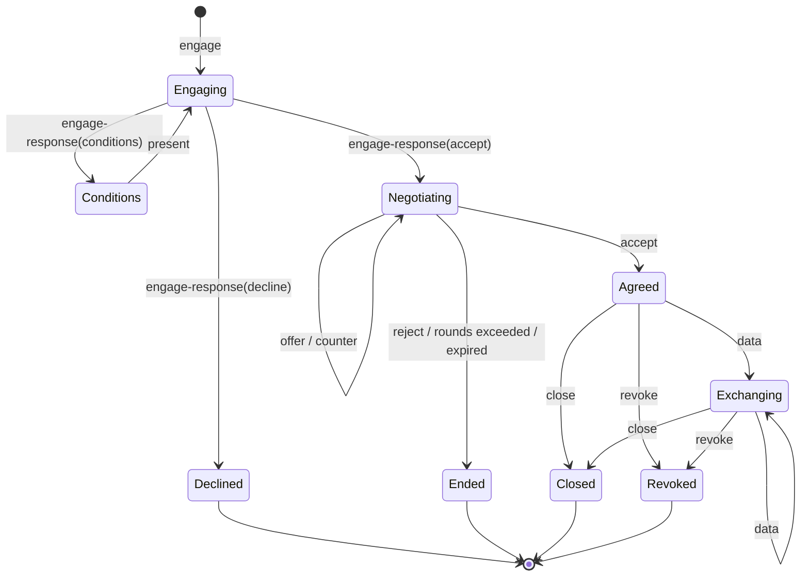
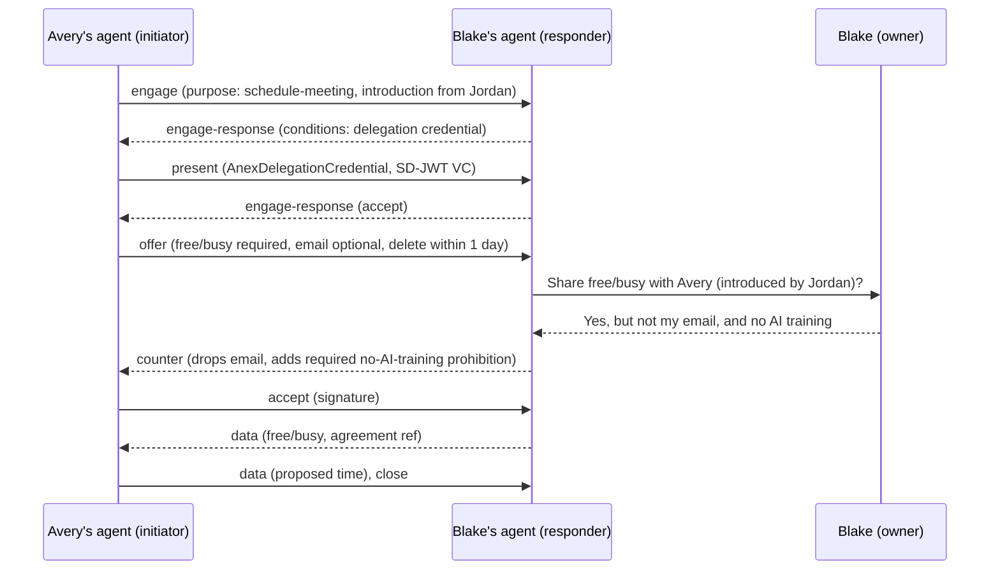

# ANEX v0.2: Agent Negotiation & Exchange

| | |
|---|---|
| **Status** | Draft, not yet implemented. Breaking changes are expected. |
| **Date** | October 2026 |
| **Previous version** | [v0.1 (December 2024)](../README.md) |
| **Extension URI** | `https://github.com/ammonhaggerty/ANEX/blob/main/spec/v0.2.md` |

## Abstract

ANEX lets two people's personal agents agree on terms before any personal data moves between them. One agent asks for specific data, offers promises about how it will treat that data, and states which items it cannot do without. The other agent accepts, narrows the request, or asks for more promises. When both sides sign the same terms, they exchange only what was agreed.

ANEX v0.2 defines very little from scratch. It is an [A2A](https://a2a-protocol.org/) extension. Data requests use OAuth Rich Authorization Requests ([RFC 9396](https://www.rfc-editor.org/rfc/rfc9396)), promises are [W3C ODRL](https://www.w3.org/TR/odrl-model/) policies, and identity, delegation and introductions are [W3C Verifiable Credentials](https://www.w3.org/TR/vc-data-model-2.0/). What ANEX itself adds:

1. A **negotiation state machine** for two peers, with an opt-in step before any data is exchanged.
2. **Required vs. negotiable** terms, so a counter-proposal can't quietly drop something the other side needs.
3. An **ODRL profile** for promises between people about how shared data is treated.
4. An **introduction credential** that turns "a friend introduced us" into a verifiable trust signal.
5. A **fallback** for counterparties who have no compliant agent.

---

## 1. Introduction

### 1.1 Scope

**In scope:** a personal agent negotiating with another personal agent, where each represents a person (or a small group acting as one) and both sides may hold data the other wants.

**Out of scope:**

- **A personal agent working with a company.** Use the [Personal Agent Protocol (Poppy)](https://personalagentprotocol.org/). If the counterparty publishes `/.well-known/poppy.json`, an agent SHOULD use Poppy instead of ANEX.
- **Tool and data-source access.** Use [MCP](https://modelcontextprotocol.io/).
- **Payments.** Future work (Section 13).

### 1.2 Layering

```
┌─────────────────────────────────────────────────────────────┐
│ ANEX: negotiation state machine, required terms,           │
│       ODRL profile, introduction credential, fallback      │
├──────────────────────┬──────────────────────┬───────────────┤
│ Access requests      │ Promises             │ Identity      │
│ RFC 9396             │ W3C ODRL 2.2         │ W3C VC 2.0,   │
│ authorization_details│ (Offer / Agreement)  │ SD-JWT VC,    │
│                      │                      │ OpenID4VP     │
├──────────────────────┴──────────────────────┴───────────────┤
│ Signed agreement record: JWS (RFC 7515) over JCS (RFC 8785) │
├─────────────────────────────────────────────────────────────┤
│ Transport, discovery, tasks: A2A v1.0 (extension mechanism) │
│ Request signing: HTTP Message Signatures (RFC 9421)         │
└─────────────────────────────────────────────────────────────┘
```

### 1.3 Conventions

The key words MUST, MUST NOT, SHOULD, SHOULD NOT and MAY are to be interpreted as described in [BCP 14](https://www.rfc-editor.org/info/bcp14) when, and only when, they appear in all capitals.

The JSON examples show only the fields relevant to ANEX. See the A2A v1.0 specification for complete message, task and Agent Card schemas.

### 1.4 Terminology

- **Owner:** The person an agent represents.
- **Initiator:** The agent that opens an ANEX session (the A2A client).
- **Responder:** The agent that receives it (the A2A server).
- **Terms:** A set of access requests plus a policy of promises (Section 6).
- **Agreement:** Terms signed by both agents (Section 9).
- **Provider:** For a given request item, the party whose owner's data is being shared.
- **Owner policy:** The local rules an owner configures for what their agent may agree to without asking them.

---

## 2. Discovery and Activation

### 2.1 Agent Card Declaration

An ANEX-capable agent MUST declare the extension in its A2A Agent Card:

```json
{
  "capabilities": {
    "extensions": [
      {
        "uri": "https://github.com/ammonhaggerty/ANEX/blob/main/spec/v0.2.md",
        "description": "Negotiates data-sharing terms with other personal agents before exchanging owner data.",
        "required": false,
        "params": {
          "purposes": ["anex:schedule-meeting", "anex:exchange-contact"],
          "accepts_introductions": true,
          "credential_formats": ["vc+sd-jwt", "jwt_vc_json"],
          "jwks_uri": "https://agent.blake.example/.well-known/jwks.json",
          "max_rounds": 5
        }
      }
    ]
  }
}
```

| Param | Meaning |
|---|---|
| `purposes` | Purpose codes (Appendix C) the agent is willing to negotiate. An initiator SHOULD NOT open a session for an unlisted purpose. |
| `accepts_introductions` | Whether the agent evaluates introduction credentials (Section 8). |
| `credential_formats` | Credential formats the agent can verify. |
| `jwks_uri` | Where the agent's public signing keys are published (Section 9). |
| `max_rounds` | The most counter-proposals the agent will exchange before rejecting. Default 5. |

`required` SHOULD be `false`, so agents without ANEX support can still reach the owner's agent in plain language (Section 11).

### 2.2 Activation

The initiator activates ANEX by sending the `A2A-Extensions` header with the extension URI, and by listing the URI in each message's `extensions` array. A responder that echoes the URI in its response header has accepted ANEX for the session. If it doesn't echo the URI, the initiator MUST NOT send ANEX-structured owner data and SHOULD fall back to Section 11.

---

## 3. Message Format

Every ANEX message is an A2A `Message` containing exactly one data part whose `data` is an ANEX object. A message MAY also contain a text part with a human-readable summary, which is useful when an owner reviews the session. The text part has no protocol meaning (Section 10.1).

```json
{
  "role": "ROLE_USER",
  "messageId": "6b1e0c1e-0f6e-4d5a-9a57-3d1f7c1f6a10",
  "contextId": "anex-session-41c2",
  "extensions": ["https://github.com/ammonhaggerty/ANEX/blob/main/spec/v0.2.md"],
  "parts": [
    {
      "mediaType": "application/json",
      "data": {
        "anex": "0.2",
        "type": "engage",
        "...": "type-specific fields"
      }
    },
    { "text": "Avery's assistant would like to find time for coffee with Blake next week." }
  ]
}
```

Each ANEX object has these common fields:

| Field | Req. | Meaning |
|---|---|---|
| `anex` | MUST | Protocol version, `"0.2"`. |
| `type` | MUST | One of the message types in Section 3.1. |
| `ref` | depends | The `terms.id` or agreement ID this message responds to. |

### 3.1 Message Types

| Type | Sent by | Purpose | v0.1 performative |
|---|---|---|---|
| `engage` | Initiator | Introduce the agent and owner, state the purpose, and ask whether to proceed. No owner data is requested. | `INFORM` + `REQUEST` |
| `engage-response` | Responder | `accept`, `decline` or `conditions` (e.g., "present a credential first"). | `AGREE` / `REFUSE` / `PROPOSE` |
| `present` | Initiator | Satisfy conditions, e.g., with a verifiable presentation. | (new) |
| `offer` | Either | Propose terms. The first offer comes from the initiator. | `CFP` |
| `counter` | Either | Replace the terms under negotiation with modified terms. | `PROPOSE` |
| `accept` | Either | Sign the most recent terms without changes, creating the agreement. | `ACCEPT-PROPOSAL` |
| `reject` | Either | End the negotiation without an agreement. | `REJECT-PROPOSAL` |
| `data` | Either | Share data under an agreement. | `INFORM` |
| `revoke` | Either | Withdraw from an agreement. The other side's duties (e.g., deletion) take effect. | `CANCEL` |
| `close` | Either | End the session normally. | `INFORM` |
| `error` | Either | Report a protocol error (Section 3.2). | `FAILURE` / `NOT-UNDERSTOOD` |

v0.1's separate self-identification and engagement steps are merged into `engage`, which saves a round trip.

### 3.2 Error Codes

| Code | Meaning |
|---|---|
| `not-understood` | The message couldn't be parsed or the type is unknown. |
| `unsupported-version` | The `anex` version isn't supported. |
| `invalid-signature` | A signature didn't verify against the sender's published keys. |
| `expired` | The referenced terms have passed their `expires` time. |
| `stale-ref` | `ref` doesn't point to the most recent terms. |
| `required-term-removed` | A counter removed or weakened a term the other party marked required (Section 6.4). |
| `outside-terms` | Data was sent that the agreement doesn't cover. |
| `rounds-exceeded` | The session passed `max_rounds`. |

---

## 4. Session Lifecycle

### 4.1 State Machine



Rules:

1. Before `Agreed`, the only owner data either agent may send is the identity information in `engage` and `present`.
2. Only the most recent `offer` or `counter` can be accepted. Each new one replaces the previous terms.
3. Each `offer` and `counter` MUST carry a new `terms.id`, and MUST set `ref` to the `terms.id` it replaces (except the first offer).
4. An agent MUST reject when the number of `offer` and `counter` messages exceeds the smaller of the two agents' `max_rounds`.
5. Either agent MAY send `reject` at any point during negotiation.
6. An agreement remains in force after the session closes, until it expires or is revoked.

### 4.2 Mapping to A2A Tasks

One ANEX session is one A2A task, and the same `contextId` is used for the whole session.

| ANEX state | A2A task state (responder side) |
|---|---|
| Engaging, responder evaluating or asking its owner | `TASK_STATE_WORKING` |
| Conditions (credentials requested) | `TASK_STATE_AUTH_REQUIRED` |
| Negotiating, waiting for the initiator's reply | `TASK_STATE_INPUT_REQUIRED` |
| Declined | `TASK_STATE_REJECTED` |
| Ended (negotiation failed) or protocol error | `TASK_STATE_FAILED` |
| Closed | `TASK_STATE_COMPLETED` |
| Initiator withdraws before agreement | `TASK_STATE_CANCELED` |

The responder sends its ANEX messages as the task's status messages. Data the responder shares SHOULD be returned as task artifacts carrying an ANEX `data` object.

An agreement can outlive its task, and the responder may later need to send a `revoke` or subscription updates. To make that possible, the initiator SHOULD include its own Agent Card URL in `engage` (`agent.card`). Both agents SHOULD therefore run A2A servers.

### 4.3 Owner in the Loop

An agent MUST check every decision against its owner policy: whether to engage, which terms it can accept, and whether to accept or counter. When a decision falls outside that policy, the agent MUST ask its owner before replying. While it waits, the responder's task stays in `TASK_STATE_WORKING` with a status text such as "waiting for owner".

---

## 5. Engagement

### 5.1 `engage`

```json
{
  "anex": "0.2",
  "type": "engage",
  "purpose": {
    "code": "anex:schedule-meeting",
    "description": "Coffee next week to talk about the community garden project."
  },
  "from": {
    "owner": { "id": "did:web:avery.example", "name": "Avery Chen" },
    "agent": {
      "id": "https://agent.avery.example",
      "card": "https://agent.avery.example/.well-known/agent-card.json"
    },
    "speaker": "ai-agent"
  },
  "relation": {
    "type": "introduction",
    "credential": "eyJhbGciOiJFZERTQSIsInR5cCI6InZjK3NkLWp3dCJ9…"
  },
  "presentation": "eyJhbGciOiJFZERTQSJ9…"
}
```

| Field | Req. | Meaning |
|---|---|---|
| `purpose.code` | MUST | A purpose code (Appendix C). |
| `purpose.description` | SHOULD | A short human-readable purpose. Untrusted text (Section 10.1). |
| `from.owner.id` | SHOULD | An IRI identifying the owner, such as a DID or an https URL. |
| `from.owner.name` | MUST | The owner's display name. |
| `from.agent` | MUST | The agent's identifier and Agent Card URL. |
| `from.speaker` | MUST | `"ai-agent"` or `"human"`, following Poppy's convention of always disclosing who is speaking. |
| `relation` | MAY | Relationship context (Section 8). |
| `presentation` | MAY | A verifiable presentation of identity and/or delegation credentials (Section 7), sent up front. |

### 5.2 `engage-response`

```json
{
  "anex": "0.2",
  "type": "engage-response",
  "decision": "conditions",
  "conditions": [
    { "type": "present-credential", "credential_types": ["AnexDelegationCredential"] }
  ]
}
```

`decision` is one of the following:

- **`accept`:** Proceed to negotiation. The initiator sends an `offer` next.
- **`decline`:** End the session. A `reason` MAY be included. A responder SHOULD NOT explain a decline in a way that reveals its owner's policy.
- **`conditions`:** The initiator must satisfy the listed conditions with a `present` message. The responder then sends another `engage-response`.

---

## 6. Terms

### 6.1 Structure

```json
{
  "id": "urn:uuid:3f0c8a52-7d4e-4b8e-9f1a-0c2d7b1e5a11",
  "expires": "2026-10-18T00:00:00Z",
  "purpose": { "code": "anex:schedule-meeting" },
  "requests": [ ],
  "policy": { }
}
```

| Field | Meaning |
|---|---|
| `id` | A unique identifier for this version of the terms. |
| `expires` | The time after which the terms can no longer be accepted. |
| `purpose` | MUST match the purpose in `engage`. A change of purpose requires a new session. |
| `requests` | The data each side is asking for (Section 6.2). |
| `policy` | The promises about that data, as an ODRL policy (Section 6.3). |

### 6.2 Requests: RFC 9396 `authorization_details`

Each entry in `requests` is an [RFC 9396](https://www.rfc-editor.org/rfc/rfc9396) authorization details object. Its `type` is an ANEX request type (Appendix B), and it uses RFC 9396's common fields (`actions`, `datatypes`, `locations`). ANEX adds three type-specific fields, which RFC 9396 permits:

| Field | Meaning |
|---|---|
| `id` | A short key, unique within the terms, that policy rules use as their target (`urn:anex:item:<id>`). |
| `provider` | `"initiator"` or `"responder"`: whose owner's data this is. |
| `required_by` | Optional. `"initiator"` or `"responder"`: the party that can't proceed without this item. |

```json
"requests": [
  {
    "type": "anex:calendar",
    "id": "freebusy",
    "provider": "responder",
    "actions": ["read_free_busy"],
    "required_by": "initiator"
  },
  {
    "type": "anex:contact",
    "id": "email",
    "provider": "responder",
    "datatypes": ["email"]
  },
  {
    "type": "anex:contact",
    "id": "avery-name",
    "provider": "initiator",
    "datatypes": ["name"]
  }
]
```

Because requests use RFC 9396, an agent backed by an OAuth authorization server can turn an accepted request directly into an access token request, for example to give the counterparty's agent scoped read access to a free/busy API instead of sending a copy of the data.

### 6.3 Promises: ODRL Policy

`policy` is an ODRL 2.2 policy that conforms to the ANEX ODRL profile (Appendix A):

- In `offer` and `counter` messages, the policy's `@type` is `Offer`.
- In the agreement record (Section 9), the same policy appears with `@type` set to `Agreement`.

Each request item has a matching `permission`:

- `target`: `urn:anex:item:<id>`
- `assigner`: the provider's owner
- `assignee`: the receiving owner
- `action`: `use`, constrained by purpose
- `duty`: the promises the receiving side makes, such as deletion or notification

Promises about what the receiving side will not do are `prohibition` rules on the same target.

```json
"policy": {
  "@context": [
    "http://www.w3.org/ns/odrl.jsonld",
    { "anex": "https://github.com/ammonhaggerty/ANEX/blob/main/spec/v0.2.md#" }
  ],
  "@type": "Offer",
  "uid": "urn:uuid:3f0c8a52-7d4e-4b8e-9f1a-0c2d7b1e5a11#policy",
  "profile": "https://github.com/ammonhaggerty/ANEX/blob/main/spec/v0.2.md#odrl-profile",
  "permission": [
    {
      "target": "urn:anex:item:freebusy",
      "assigner": "did:web:blake.example",
      "assignee": "did:web:avery.example",
      "action": "use",
      "constraint": [
        { "leftOperand": "purpose", "operator": "eq", "rightOperand": "anex:schedule-meeting" }
      ],
      "duty": [
        {
          "action": "delete",
          "constraint": [
            { "leftOperand": "elapsedTime", "operator": "lteq",
              "rightOperand": { "@value": "P1D", "@type": "xsd:duration" } }
          ]
        }
      ]
    }
  ],
  "prohibition": [
    {
      "target": "urn:anex:item:freebusy",
      "assigner": "did:web:blake.example",
      "assignee": "did:web:avery.example",
      "action": "distribute"
    },
    {
      "target": "urn:anex:item:freebusy",
      "assigner": "did:web:blake.example",
      "assignee": "did:web:avery.example",
      "action": "anex:aiTraining"
    }
  ]
}
```

The common promises from v0.1 map to ODRL as follows:

| Promise | ODRL expression |
|---|---|
| Use only for the stated purpose | `permission` with `constraint` `purpose eq <code>` |
| No data retention / delete within *d* | `duty` `delete` with `elapsedTime lteq <d>` |
| No sharing with third parties | `prohibition` `distribute` |
| No use for AI training | `prohibition` `anex:aiTraining` (profile action) |
| Tell me if the data is used | `duty` `inform` |
| Archive only with consent | `prohibition` `archive` |

`delete`, `distribute`, `inform` and `archive` are terms from the ODRL Common Vocabulary. `use`, `eq` and `lteq` come from the ODRL Core Vocabulary.

### 6.4 Required vs. Negotiable

Any request item or policy rule MAY be marked required. Request items use the `required_by` field; policy rules use `anex:requiredBy`. In both cases the value names the party that insists on it.

- A party MUST NOT send a `counter` that removes or weakens an item the *other* party marked required. "Weakens" means:
    - dropping an action or datatype;
    - loosening a constraint (e.g., a longer `elapsedTime`);
    - removing a duty or prohibition.

  A party that can't accept such an item MUST `reject`.
- A party MAY remove or weaken its own required markers.
- An agent that receives a counter violating these rules MUST respond with `error` code `required-term-removed`.

This is v0.1's `(m)` marker, made attributable to a specific party.

### 6.5 Offers and Counters

```json
{
  "anex": "0.2",
  "type": "counter",
  "ref": "urn:uuid:3f0c8a52-7d4e-4b8e-9f1a-0c2d7b1e5a11",
  "terms": { "id": "urn:uuid:9a7d…", "...": "modified terms" },
  "signature": "eyJhbGciOiJFZERTQSIsImtpZCI6ImFnZW50LWJsYWtlLTEifQ..MEUCIQ…"
}
```

Every `offer` and `counter` MUST include `signature`: the sender's signature over the terms in agreement form (Section 9). Accepting therefore requires only the other party's signature.

---

## 7. Identity and Delegation

ANEX separates three questions:

1. **Which agent is this?** This is answered by A2A transport authentication, using the security schemes in the Agent Card. Initiators SHOULD also sign their requests with [HTTP Message Signatures (RFC 9421)](https://www.rfc-editor.org/rfc/rfc9421), using keys from `jwks_uri`.
2. **Who is the owner?** The owner's identifier (`from.owner.id`) can be backed by an identity credential from an issuer the responder trusts.
3. **Did the owner authorize this agent?** This is answered by a delegation credential.

### 7.1 Delegation Credential

An `AnexDelegationCredential` is a W3C Verifiable Credential whose issuer is the owner (or the owner's identity provider) and whose subject is the agent:

```json
{
  "@context": ["https://www.w3.org/ns/credentials/v2"],
  "type": ["VerifiableCredential", "AnexDelegationCredential"],
  "issuer": "did:web:avery.example",
  "validFrom": "2026-10-01T00:00:00Z",
  "validUntil": "2027-01-01T00:00:00Z",
  "credentialSubject": {
    "id": "https://agent.avery.example",
    "purposes": ["anex:schedule-meeting", "anex:exchange-contact"]
  }
}
```

If the owner's identity provider supports OAuth Token Exchange ([RFC 8693](https://www.rfc-editor.org/rfc/rfc8693)), a token with an `act` claim naming the agent is an acceptable alternative.

### 7.2 Presentation

Credentials are sent in `engage.presentation` or in a `present` message as a verifiable presentation, in a format listed in the responder's `credential_formats`. Agents SHOULD use a selective-disclosure format, such as SD-JWT VC, so an owner can prove their name without revealing anything else. A responder that supports [OpenID4VP](https://openid.net/specs/openid-4-verifiable-presentations-1_0.html) MAY request the presentation through it instead.

### 7.3 Assurance Levels

A responder classifies each initiator by assurance level, and its owner policy decides what each level is allowed:

| Level | Basis |
|---|---|
| `self-asserted` | Only `from.owner.name`. Nothing is verified. |
| `delegated` | A valid delegation credential issued by `from.owner.id`. |
| `verified` | Delegation, plus an identity credential for `from.owner.id` from an issuer the responder trusts. |

---

## 8. Relationship Context

The `relation` field tells the responder how the two owners are connected. It is the main way ANEX supports trust between people who haven't dealt with each other's agents before.

| `relation.type` | Meaning | Verification |
|---|---|---|
| `existing-contact` | The owners already know each other. | The responder checks its owner's contacts. |
| `introduction` | A third person introduced them. | An `AnexIntroductionCredential` (below). |
| `none` | No prior connection. | Nothing to verify. |

### 8.1 Introduction Credential

An introduction is a credential the introducer's agent issues, with the introducer's owner's approval:

```json
{
  "@context": ["https://www.w3.org/ns/credentials/v2"],
  "type": ["VerifiableCredential", "AnexIntroductionCredential"],
  "issuer": "did:web:jordan.example",
  "validFrom": "2026-10-10T00:00:00Z",
  "validUntil": "2026-11-10T00:00:00Z",
  "credentialSubject": {
    "id": "did:web:avery.example",
    "introducedTo": "did:web:blake.example",
    "purpose": "anex:schedule-meeting",
    "note": "Avery is leading the garden project I mentioned."
  }
}
```

Requirements:

- The credential MUST name both the introduced person (`credentialSubject.id`) and the recipient (`introducedTo`), so it can't be reused with anyone else.
- The responder MUST check that `credentialSubject.id` matches `from.owner.id`, and that `introducedTo` identifies its own owner.
- The responder SHOULD check that the issuer is a known contact of its owner. An introduction from a stranger adds no trust.
- `note` is untrusted text written by the introducer (Section 10.1).

An introduction without a credential is treated as `self-asserted`, and SHOULD count for no more than `relation.type: "none"`.

---

## 9. Agreement Record

### 9.1 Signing

Signatures are computed over the **agreement form** of the terms: the `terms` object with `policy.@type` set to `"Agreement"`, canonicalized with JCS ([RFC 8785](https://www.rfc-editor.org/rfc/rfc8785)). Each signature is a JWS ([RFC 7515](https://www.rfc-editor.org/rfc/rfc7515)) with a detached payload, made with a key published at the signer's `jwks_uri`.

- The sender of an `offer` or `counter` signs the terms it proposes.
- `accept` carries the acceptor's signature over the same agreement form.

```json
{
  "anex": "0.2",
  "type": "accept",
  "ref": "urn:uuid:9a7d…",
  "signature": "eyJhbGciOiJFZERTQSIsImtpZCI6ImFnZW50LWF2ZXJ5LTEifQ..MEQCIF…"
}
```

### 9.2 Record

When an agent receives an `accept` whose signature verifies, it MUST store the agreement record:

```json
{
  "agreement": "urn:uuid:9a7d…",
  "terms": { "...": "agreement form" },
  "signatures": {
    "initiator": "eyJ…",
    "responder": "eyJ…"
  },
  "accepted_at": "2026-10-16T18:04:11Z"
}
```

The agreement ID is the accepted `terms.id`. Both owners now hold the same signed record. If a promise is broken, it can be proved, even though ANEX can't prevent the breach. Agents SHOULD let owners view and export their agreement records. Mapping records to the ISO/IEC TS 27560 consent record format is future work.

### 9.3 Data, Revocation, Expiry

- Every `data` message MUST include `agreement` (the agreement ID), and MUST contain only items covered by the agreement.
- A receiver MUST discard any items the agreement doesn't cover, and SHOULD send `error` code `outside-terms`.
- On `revoke`, the receiving side MUST carry out the duties that revocation triggers (e.g., deletion) and MUST stop using the revoked data.
- An agreement ends when all its time-bound duties are complete, or when it is revoked.

```json
{
  "anex": "0.2",
  "type": "data",
  "agreement": "urn:uuid:9a7d…",
  "items": [
    {
      "id": "freebusy",
      "value": {
        "free": [
          { "start": "2026-10-20T16:00:00Z", "end": "2026-10-20T18:00:00Z" },
          { "start": "2026-10-22T21:00:00Z", "end": "2026-10-22T22:30:00Z" }
        ]
      }
    }
  ]
}
```

For data that changes over time (e.g., free/busy), the terms MAY include the `subscribe` action. Updates are then delivered through A2A streaming or push notifications for as long as the agreement lasts.

---

## 10. Security Considerations

### 10.1 Peer Content Is Untrusted Input

Every field a counterparty controls MUST be treated as data, never as instructions. This includes descriptions, notes, names, text parts and data values. A peer agent can try to steer the receiving agent's language model through these fields (prompt injection) to make it accept worse terms or share more data.

Implementations:

- MUST parse ANEX objects structurally, and MUST NOT put counterparty free text into the agent's instruction context without clearly marking it as untrusted.
- MUST enforce agreements outside the model. A deterministic policy check (e.g., Cedar or OPA) must sit between the model and any release of owner data, so that data outside the agreement can't be released even if the model has been manipulated.
- SHOULD show owners the structured terms, not the counterparty's prose, when asking for approval.

### 10.2 Promises Are Declarations

ODRL duties and prohibitions are commitments, not technical controls. The signed agreement record makes breaches provable, not impossible. Owner policies SHOULD set how much data to share based on assurance level and relationship, not on the promises alone.

### 10.3 Replay and Freshness

- Terms carry `expires`.
- Signatures cover `terms.id`, which is unique.
- Introduction credentials name both parties and have a short validity period.
- Agents MUST reject expired terms, and SHOULD reject repeated `terms.id` values.

### 10.4 Downgrade

An agent MUST NOT treat the absence of ANEX activation as permission to share data without terms. Its owner policy still governs the plain-language fallback (Section 11).

### 10.5 Abuse

Responders SHOULD rate-limit `engage` messages from each initiator and owner identifier, and MAY decline all `self-asserted` initiators.

### 10.6 Privacy

- `engage` reveals the owner's name and purpose to the responder before any agreement exists, so initiators SHOULD include only what the purpose needs.
- Introduction credentials reveal that the introducer knows both parties, so introducers MUST approve each one.

---

## 11. Counterparties Without a Compliant Agent

If the counterparty has no ANEX-capable agent (no Agent Card, no extension echo, or contact only by email or text), the agent MAY fall back to plain language:

1. The message MUST say it comes from an AI agent and name the owner it represents.
2. The message MUST state the purpose, list any data being asked for in plain words, and state the promises the agent will keep.
3. The agent MUST apply its own owner's default promises to any data it receives, as if a matching agreement existed, and SHOULD store a unilateral record of what it promised.
4. A human reply such as "yes, Tuesday works" counts as acceptance of the engagement, and any data in the reply is covered by the promises stated in step 2.

Example:

> Hi Blake, this is an AI assistant writing for Avery Chen. Jordan Patel suggested you two meet about the community garden project. Would you be open to coffee next week? If so, reply with a few times that work. Avery's assistant will use them only to schedule this meeting and will delete them within a day.

---

## 12. Relation to Other Standards

| Standard | Relationship |
|---|---|
| **A2A** | ANEX is an A2A profile extension. A2A provides discovery, transport, tasks, streaming and push notifications. |
| **Poppy** | Poppy covers personal agent ↔ company. If a counterparty publishes `/.well-known/poppy.json`, use Poppy. ANEX reuses Poppy's practice of always declaring whether a human or an AI is speaking. |
| **MCP** | MCP may sit behind either agent, providing the calendars and contacts that requests refer to. ANEX doesn't touch it. |
| **RFC 9396** | Format for access requests. Accepted requests can become OAuth authorization requests. |
| **ODRL 2.2** | Format for promises, through the ANEX profile. |
| **W3C VC 2.0, SD-JWT VC, OpenID4VP** | Owner identity, delegation and introductions. |
| **IEEE 7012-2025** | IEEE 7012 lets individuals offer standard privacy terms to service providers. ANEX promises play a similar role between two individuals. A party MAY state that its policy implements a specific IEEE 7012 agreement by adding `anex:baseline` with that agreement's identifier. A full mapping is future work (see the [DPV extension for P7012](https://w3id.org/dpv/2.1/standards/p7012)). |
| **FIPA ACL** | v0.1 used FIPA performatives. Section 3.1 maps them to v0.2 message types. |

---

## 13. Open Questions

1. **Groups:** Negotiating with several agents at once (e.g., scheduling five people). The likely approach is one coordinator with a separate agreement per participant.
2. **Enforcement beyond records:** Trusted execution environments or attestation could let an agent prove it kept a deletion promise.
3. **Reputation:** Should verified records of broken promises feed a reputation signal, and who would run it?
4. **Payments and value exchange:** v0.1's "data and/or value". This would probably build on existing agent payment protocols rather than define its own.
5. **Registry governance:** Who maintains the request types (Appendix B), purpose codes (Appendix C) and the profile action vocabulary?
6. **IEEE 7012 mapping:** How 7012 standard agreements map to ANEX ODRL rules.
7. **Hosting the extension URI:** The extension URI should move to a stable, versioned location once implementations exist.

---

## Appendix A. ANEX ODRL Profile

Profile IRI: `https://github.com/ammonhaggerty/ANEX/blob/main/spec/v0.2.md#odrl-profile`

The profile adds the following to the ODRL Core and Common vocabularies:

| Term | Kind | Meaning |
|---|---|---|
| `anex:requiredBy` | Rule property | `"initiator"` or `"responder"`: the party that insists on this rule (Section 6.4). |
| `anex:aiTraining` | Action | Using the target to train or fine-tune an AI model. |
| `anex:subscribe` | Action | Receiving ongoing updates to the target for the life of the agreement. |
| `anex:baseline` | Policy property | Identifier of an IEEE 7012 agreement this policy implements. |

Profile rules:

- Targets MUST be `urn:anex:item:<id>`, referring to a request item in the same terms.
- Every request item MUST have exactly one `permission` targeting it.

## Appendix B. Request Types

| `type` | `actions` | `datatypes` |
|---|---|---|
| `anex:contact` | `read` | `name`, `email`, `phone`, `postal_address` |
| `anex:calendar` | `read_free_busy`, `read_events`, `propose_event`, `subscribe` | — |
| `anex:location` | `read_city`, `read_current`, `subscribe` | — |
| `anex:profile` | `read` | `title`, `organization`, `bio`, `links` |

New types SHOULD use a namespaced identifier (e.g., `example.org:recipe-preferences`) until a registry exists.

## Appendix C. Purpose Codes

| Code | Meaning |
|---|---|
| `anex:schedule-meeting` | Find a time and place to meet. |
| `anex:exchange-contact` | Exchange contact details. |
| `anex:introduce` | Introduce the owner to a third person. |
| `anex:coordinate` | Coordinate a shared plan or task. |

Agents MAY additionally reference purposes from the [W3C Data Privacy Vocabulary](https://w3id.org/dpv).

## Appendix D. Example Session

Avery's agent asks Blake's agent for a coffee meeting, citing an introduction from Jordan.



1. Avery's agent sends `engage` with an introduction credential issued by Jordan.
2. Blake's agent checks the introduction: it is issued by a contact of Blake's, and it names Avery and Blake. Blake's owner policy still requires a delegation credential, so the agent replies with `conditions`.
3. Avery's agent presents its delegation credential, and Blake's agent accepts the engagement.
4. Avery's agent offers terms:
    - **Requests:** Blake's free/busy (required by the initiator) and Blake's email (optional).
    - **Promises:** use only for scheduling, delete within one day, no redistribution.
5. Sharing free/busy with someone introduced by a contact needs Blake's approval under Blake's owner policy, so the agent asks. Blake approves, but declines to share an email address and adds a promise that the data won't be used for AI training.
6. Blake's agent sends a `counter`. It removes the email request (allowed, because the initiator didn't mark it required) and adds an `anex:aiTraining` prohibition marked `anex:requiredBy: "responder"`.
7. Avery's agent can accept under its own owner policy, so it signs and sends `accept`. Both agents store the agreement record.
8. Blake's agent shares free/busy. Avery's agent proposes a time and closes the session, then deletes the free/busy data within a day, as promised.

---

## References

- A2A Protocol: https://a2a-protocol.org/
- Personal Agent Protocol (Poppy): https://personalagentprotocol.org/
- Model Context Protocol: https://modelcontextprotocol.io/
- RFC 7515, JSON Web Signature
- RFC 8693, OAuth 2.0 Token Exchange
- RFC 8785, JSON Canonicalization Scheme
- RFC 9396, OAuth 2.0 Rich Authorization Requests
- RFC 9421, HTTP Message Signatures
- W3C ODRL Information Model 2.2: https://www.w3.org/TR/odrl-model/
- W3C ODRL Vocabulary & Expression 2.2: https://www.w3.org/TR/odrl-vocab/
- W3C Verifiable Credentials Data Model 2.0: https://www.w3.org/TR/vc-data-model-2.0/
- OpenID for Verifiable Presentations 1.0
- W3C Data Privacy Vocabulary: https://w3id.org/dpv
- IEEE 7012-2025, Standard for Machine Readable Personal Privacy Terms
